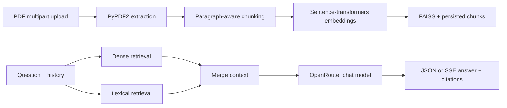

# DocuMind AI Copilot

[](https://github.com/Yashsh101/documind-ai-copilot/actions/workflows/ci.yml)
[](LICENSE)

A FastAPI document Q&A service that extracts text from PDFs, creates local sentence-transformers embeddings, persists a FAISS index, and uses an OpenRouter chat model to generate answers with source metadata. It supports JSON responses and Server-Sent Events (SSE).

## Problem

Teams often need answers from policy and operational documents without losing the source context. DocuMind keeps ingestion, retrieval, answer generation, and streaming behind a small API surface. It is a portfolio project, not a claim of production scale or measured latency.

## Demo / status

The repository includes a static browser client at `/` and API docs at `/docs`. The previously documented Render deployment returned HTTP 503 (`suspend-by-user`) on 2026-10-03, so the public deployment is **pending verification**. No live demo or performance number is claimed until the service returns 200 from `/api/v1/health`.

## Architecture



### Key engineering decisions

- **Local embeddings:** `all-MiniLM-L6-v2` is the default; first use may download model assets.
- **Filesystem persistence:** FAISS index, chunks, and metadata are stored under `DATA_DIR`.
- **Two response modes:** `POST /api/v1/query` returns JSON; `POST /api/v1/chat/stream` returns SSE.
- **Bounded uploads:** PDF extension, file-size, and page-count limits are checked before ingestion.
- **Graceful provider errors:** quota and provider failures return structured error responses; streaming emits an error event.

See [`docs/architecture.md`](docs/architecture.md) for the verified component map.

## Quickstart

### 1. Clone and install

```bash
git clone https://github.com/Yashsh101/documind-ai-copilot.git
cd documind-ai-copilot
python3 -m venv .venv
. .venv/bin/activate          # Windows: .venv\\Scripts\\Activate.ps1
python -m pip install --upgrade pip
python -m pip install -r requirements-dev.txt
```

### 2. Configure

```bash
cp .env.example .env
# Set OPENROUTER_API_KEY for real answers; keep keys out of git.
```

The local embedding model may download on first use. Provider calls require an OpenRouter key; tests mock the provider boundary.

### 3. Run

```bash
python -m uvicorn app.main:app --reload --port 8000
curl http://localhost:8000/api/v1/health
```

Open `http://localhost:8000` for the static client or `http://localhost:8000/docs` for Swagger UI.

## API contract

### Health

```bash
curl http://localhost:8000/api/v1/health
```

### Upload one or more PDFs

```bash
curl -X POST http://localhost:8000/api/v1/upload \
  -F 'files=@sample.pdf'
```

The upload route rejects non-PDF files, oversized files, and PDFs without extractable text. It returns document IDs, chunk count, and warnings for partial batches.

### Synchronous query

```bash
curl -X POST http://localhost:8000/api/v1/query \
  -H 'Content-Type: application/json' \
  -d '{"question":"What is the refund policy?","session_id":"demo"}'
```

### Streaming query

```bash
curl -N -X POST http://localhost:8000/api/v1/chat/stream \
  -H 'Content-Type: application/json' \
  -d '{"question":"Summarize the policy.","session_id":"demo"}'
```

## Evaluation

- **Dataset:** No representative labeled dataset is committed. `tests/` contains route-level regression coverage, not retrieval-quality evidence.
- **Metrics:** Retrieval quality, citation precision/recall, faithfulness, latency, and throughput are **pending verification**.
- **Baseline:** No baseline comparison is claimed because there is no checked-in evaluation corpus or reproducible benchmark harness.
- **Reproduction:** `python -m pytest -q` reproduces the current automated checks. Run `ruff check .`, `python -m compileall -q app tests`, and `docker build -t documind-ai-copilot:ci .` for the full local gate.
- **Next evaluation step:** Add a small anonymized golden QA set with expected citations, then compare lexical-only, dense-only, and combined retrieval.

## Failure cases and security

- Scanned PDFs with no extractable text require OCR, which is not implemented.
- Missing/invalid provider credentials return structured errors; the application does not silently invent an answer.
- The FAISS index and conversation memory are process/filesystem local; they are not durable multi-tenant storage.
- Uploads and generated data may contain sensitive documents. Do not commit `.env`, API keys, private PDFs, `data/`, or persisted indexes.
- Configure `CORS_ORIGINS`, upload limits, and rate limits for deployment. Do not use example keys outside local testing.

## Verification

```bash
ruff check .
python -m pytest -q
python -m compileall -q app tests
python -m pip check
```

CI runs the committed development install, Ruff, pytest, and Docker build. Current local verification previously passed 2 tests and compilation; expand the suite before claiming broad production readiness.

## Deployment status

Docker, Render, and Railway configuration files are present. The Render health endpoint was unavailable during the last audit; deployment is **pending verification**. A deployment should set `OPENROUTER_API_KEY`, restrict CORS, configure persistent storage if documents must survive restarts, and verify `/api/v1/health` before sharing a URL.

## Limitations and roadmap

1. Add retrieval/citation evaluation with a small documented golden set.
2. Add OCR support for scanned PDFs.
3. Add persistence and isolation suitable for multi-user deployments.
4. Add end-to-end streaming and upload integration tests.
5. Publish a reproducible latency/throughput benchmark only after dataset and hardware are fixed.

## License

MIT — see [`LICENSE`](LICENSE).
