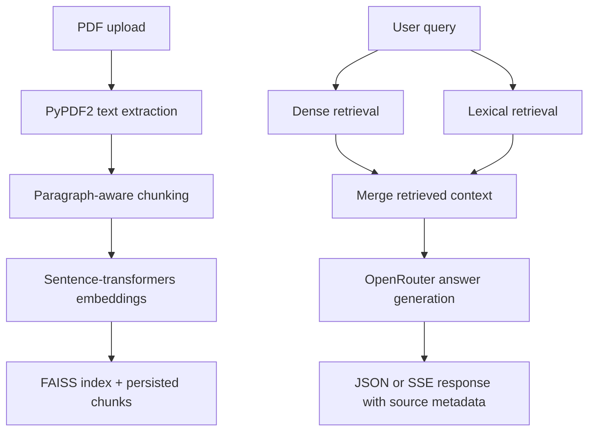

# DocuMind AI — Architecture

## Verified stack

| Layer | Technology |
|---|---|
| API | FastAPI, Uvicorn, multipart uploads |
| Embeddings | `sentence-transformers` with `all-MiniLM-L6-v2` by default |
| Vector store | FAISS in-memory index persisted to the configured data directory |
| Retrieval | Dense vector search plus BM25-style lexical retrieval in the RAG service |
| LLM | OpenRouter chat-completions API by default; model and endpoint are configurable |
| Streaming | Server-Sent Events from the chat route |
| Storage | Local filesystem data directory; persistence behavior depends on deployment storage |
| Deployment | Dockerfile and Render configuration are present; public Render health check was unavailable during the 2026-10-03 audit |

## RAG pipeline

## Repository layout

- `app/main.py`: FastAPI application entry point.
- `app/routes/`: upload, chat, and health endpoints.
- `app/services/embeddings.py`: embedding model, FAISS index, persistence, and search.
- `app/services/rag.py`: memory, LLM calls, chunking, ingestion, and query pipeline.
- `app/config.py`: environment-backed settings.
- `app/static/`: lightweight browser client assets served by the API.
- `tests/`: current route tests.
- `Dockerfile`, `render.yaml`, and `railway.toml`: deployment configuration.

## Configuration and limitations

- LLM requests require `OPENROUTER_API_KEY` unless a test substitutes the service boundary.
- Embedding model loading can download model assets on first use; this is not an offline-only application.
- FAISS and uploaded document state are filesystem-backed. Ephemeral deployment storage can lose the index and documents when the instance restarts.
- Conversation memory is process-local and should not be treated as durable multi-user state.
- The repository currently has a small test suite relative to the feature surface; retrieval quality, citation faithfulness, latency, and throughput remain **pending verification** without a checked-in evaluation dataset and benchmark harness.
